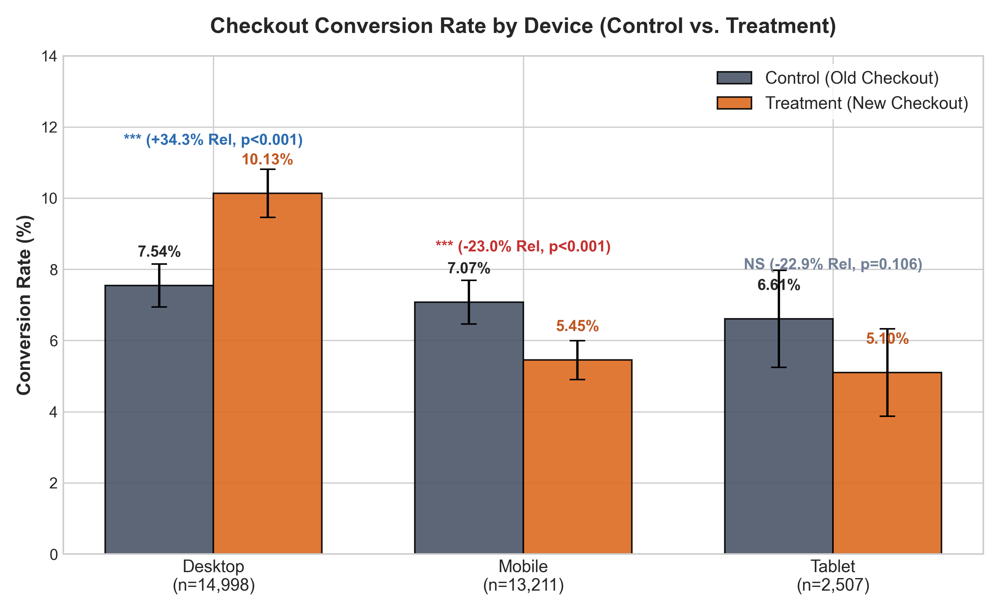
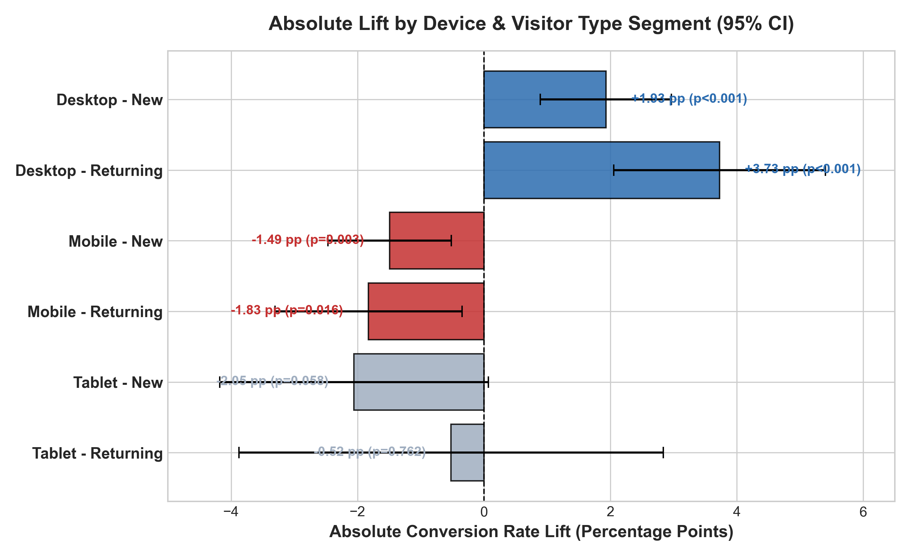
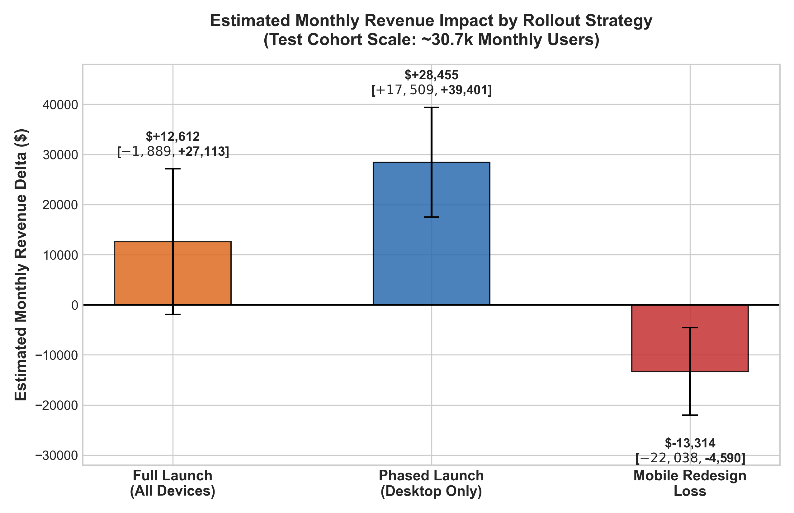

# Etsy Checkout Redesign A/B Test: Experiment Analysis & Launch Recommendation

**Role:** Senior Product Analyst, Checkout Team  
**Stakeholders:** Head of Product, Checkout Engineering Team, Design Team  
**Test Window:** September 2, 2025 – September 29, 2025 (4 Weeks)  
**Deliverable Artifacts:** `README.md`, `checkout_ab_test_analysis.ipynb`, `checkout_ab_test_analysis.py`, `charts/`

---

## Executive Summary & Launch Recommendation

### **Recommendation: CHANGE & RETEST (PHASED LAUNCH)**
- **Desktop Rollout:** **LAUNCH IMMEDIATELY** to 100% of Desktop users.
- **Mobile & Tablet Rollout:** **DO NOT LAUNCH**. Retain Mobile and Tablet users on the Control checkout.
- **Next Steps:** Conduct mobile UX usability audits, address touch-friction bugs, fix mobile wallet placement, and launch a dedicated Mobile A/B retest.

---

### **Key Decision Rationale & Data Evidence**

| Rollout Strategy | Conversion Rate Impact | Revenue Per User (RPU) | Monthly Revenue Impact (Test Scale) | Recommendation & Risk Assessment |
| :--- | :--- | :--- | :--- | :--- |
| **Full Launch (All Devices)** | +0.47 pp (+6.47% rel, $p = 0.1180$) | +$0.41 (95% CI: [-$0.06, +$0.88]) | **+$12,612** (95% CI: [-$1,889, +$27,113]) | **HIGH RISK / SUBOPTIMAL:** Obscures massive mobile drop (-23%). High uncertainty ($p > 0.05$). |
| **Phased Launch (Desktop Only)** | **+2.59 pp** (**+34.34%** rel, **$p < 0.0001$**) | **+$1.90** (95% CI: [+$1.17, +$2.63]) | **+$28,455** (95% CI: **[+$17,509, +$39,401]**) | **RECOMMENDED:** Captures **100% of desktop revenue upside** while avoiding all mobile loss. |
| **Mobile Redesign Impact** | **-1.63 pp** (**-22.99%** rel, **$p = 0.0001$**) | **-$1.01** (95% CI: [-$1.67, -$0.35]) | **-$13,314** (95% CI: **[-$22,038, -$4,590]**) | **BLOCKER:** Severe UX regression on mobile. Must not launch to mobile users. |

---

## 1. Data Integrity Audit & Experiment Validation

Before calculating metrics, we performed a thorough experiment audit on `assignments.csv` (31,284 rows) and `orders.csv` (2,670 rows).

### Identified Integrity Issues & Handling Decisions

1. **Cross-Variant Contamination (Mixed Users):**
   - **Issue:** 284 unique users were assigned to **both Control and Treatment** across 568 assignment rows (0.92% of total users). This occurred due to cross-device/cookie tracking instability when users visited from multiple devices.
   - **Handling Decision:** **EXCLUDE ALL 284 MIXED USERS** (and their 568 assignment rows + 19 orders) from the analysis.
   - **Rationale:** Exposing a user to both old and new checkout flows violates the **Single Unit Treatment Value Assumption (SUTVA)** and causes behavioral pollution.

2. **Temporal Anomaly (Pre-Assignment Orders):**
   - **Issue:** 85 orders from clean single-variant users were placed *prior* to the user's recorded assignment timestamp (including 11 orders placed in late August 2025).
   - **Handling Decision:** **EXCLUDE ALL PRE-ASSIGNMENT ORDERS**.
   - **Rationale:** Orders placed before assignment cannot be causally attributed to the checkout redesign.

3. **Sample Ratio Mismatch (SRM) Check:**
   - **Target Split:** Planned 50 / 50 allocation.
   - **Observed Split (Clean Cohort):** 15,339 Control (49.94%) vs. 15,377 Treatment (50.06%).
   - **Goodness-of-Fit Test:** $\chi^2 = 0.0470, p = 0.8283$.
   - **Conclusion:** **PASS**. No SRM detected. The randomization mechanism performed correctly.

### Exclusions & Final Clean Sample

```
Raw Assigned Rows: 31,284  ──►  Remove Mixed User Rows (-568)  ──► Clean Users: 30,716
                                                                ├── Control:   15,339 (49.94%)
                                                                └── Treatment: 15,377 (50.06%)

Raw Order Rows:    2,670   ──►  Remove Pre-Assignment (-85)
                           ──►  Remove Mixed User Orders (-19) ──► Valid Orders: 2,566
                                                                ├── Control:   1,242
                                                                └── Treatment: 1,324
```

---

## 2. Primary & Secondary Metrics Evaluation

### Primary Metric: Conversion Rate
Defined as the percentage of assigned users who placed at least one post-assignment order during the test period.

- **Control Conversion Rate:** **7.2625%** ($1,114 / 15,339$)
- **Treatment Conversion Rate:** **7.7323%** ($1,189 / 15,377$)
- **Absolute Lift:** **+0.4698 percentage points** (+0.47 pp)
- **Relative Lift:** **+6.47%**
- **95% Confidence Interval (Abs Lift):** `[-0.1192%, +1.0588%]`
- **Hypothesis Test (Two-Sample Z-Test):** $Z = 1.5633, p = 0.1180$ (Not statistically significant at $\alpha = 0.05$).

### Secondary Metric: Average Order Value (AOV)
Defined as total order revenue divided by total orders placed.

- **Control AOV:** **$63.50** ($78,867.55 / 1,242$)
- **Treatment AOV:** **$64.48** ($85,376.74 / 1,324$)
- **Absolute Difference:** **+$0.98** (+1.55%)
- **95% Confidence Interval:** `[-$1.03, +$3.00]`
- **Hypothesis Test (Welch's t-test):** $t = 0.9567, p = 0.3388$ (Not statistically significant).

### Secondary Metric: Revenue Per User (RPU / ARPU)
Defined as total revenue generated divided by total assigned users.

- **Control RPU:** **$5.14** ($78,867.55 / 15,339$)
- **Treatment RPU:** **$5.55** ($85,376.74 / 15,377$)
- **Absolute Difference:** **+$0.41** (+7.99%)
- **95% Confidence Interval:** `[-$0.06, +$0.88]`
- **Hypothesis Test (Welch's t-test):** $t = 1.7047, p = 0.0883$ (Marginally non-significant).

### Statistical Assumptions
1. **SUTVA (Single Unit Treatment Value Assumption):** Satisfied after dropping all 284 mixed users.
2. **Independence:** User sessions and purchasing decisions are assumed independent across individuals.
3. **Normality / Central Limit Theorem:** Large sample size ($N = 30,716$) ensures normal distribution for standard error calculations.

---

## 3. Segment Analysis: Device & Visitor Type Breakdown

Evaluating aggregate results alone conceals dramatic opposing effects across device types—a classic manifestation of **Simpson's Paradox**.

### Device Breakdown (Key Discovery)



| Device | Control Users | Treatment Users | Control Conv | Treatment Conv | Absolute Lift (pp) | Relative Lift (%) | Z-Statistic | p-Value | Significant? (alpha=0.0167) | Control RPU | Treatment RPU | RPU Delta |
| :--- | :---: | :---: | :---: | :---: | :---: | :---: | :---: | :---: | :---: | :---: | :---: | :---: |
| **Desktop** | 7,410 | 7,588 | **7.54%** | **10.13%** | **+2.59 pp** | **+34.34%** | **5.5980** | **< 0.0001** | **YES (Huge Win)** | $5.38 | $7.28 | **+$1.90** |
| **Mobile** | 6,658 | 6,553 | **7.07%** | **5.45%** | **-1.63 pp** | **-22.99%** | **-3.8619** | **0.0001** | **YES (Major Drop)** | $4.95 | $3.94 | **-$1.01** |
| **Tablet** | 1,271 | 1,236 | **6.61%** | **5.10%** | **-1.51 pp** | **-22.88%** | **-1.6144** | **0.1064** | No (Directionally negative) | $4.73 | $3.47 | **-$1.26** |

*Note: Bonferroni correction for 3 simultaneous device hypotheses requires $\alpha_{adj} = 0.05 / 3 = 0.0167$. Both Desktop ($p < 0.0001$) and Mobile ($p = 0.0001$) easily pass this corrected significance threshold.*

---

### Visitor Type Breakdown

| Visitor Type | Control Users | Treatment Users | Control Conv | Treatment Conv | Absolute Lift (pp) | Relative Lift (%) | Z-Statistic | p-Value | Control RPU | Treatment RPU | RPU Delta |
| :--- | :---: | :---: | :---: | :---: | :---: | :---: | :---: | :---: | :---: | :---: | :---: |
| **New Visitors** | 9,513 | 9,611 | 6.10% | 6.24% | +0.15 pp | +2.39% | 0.4194 | 0.6749 | $4.22 | $4.58 | +$0.36 |
| **Returning Visitors** | 5,826 | 5,766 | 9.17% | 10.22% | +1.05 pp | +11.45% | 1.9094 | 0.0562 | $6.65 | $7.18 | +$0.53 |

---

### Cross-Segment Matrix (Device x Visitor Type)



- **Desktop - Returning:** **+3.73 pp** (+37.58% relative lift, $p < 0.0001$) — *Strongest performing segment!*
- **Desktop - New:** **+1.93 pp** (+31.74% relative lift, $p = 0.0003$) — *Strong positive uplift.*
- **Mobile - New:** **-1.49 pp** (-24.21% relative drop, $p = 0.0027$) — *Severe drop.*
- **Mobile - Returning:** **-1.83 pp** (-21.31% relative drop, $p = 0.0155$) — *Severe drop.*

---

## 4. Financial Revenue Impact Estimation

We modeled estimated monthly revenue impact under different rollout strategies for the test cohort scale (~30,716 users/month) and normalized per 100,000 users.



### Financial Impact Model Summary

1. **Full Launch (All Devices):**
   - **Expected Monthly Delta:** **+$12,612.01**
   - **95% Confidence Interval:** `[-$1,888.67, +$27,113.70]`
   - **Normalized per 100k Monthly Users:** +$41,060.08 (95% CI: `[-$6,148.82, +$88,268.97]`)
   - *Risk:* High variance; confidence interval crosses zero due to mobile loss offsetting desktop gain.

2. **Phased Launch (Desktop Only - RECOMMENDED):**
   - **Expected Monthly Delta:** **+$28,455.00**
   - **95% Confidence Interval:** `[+$17,508.56, +$39,401.45]`
   - **Normalized per 100k Desktop Monthly Users:** **+$189,725.31** (95% CI: `[+$116,739.27, +$262,711.34]`)
   - *Advantage:* Guaranteed positive financial return; zero risk of mobile degradation.

3. **Mobile Redesign Loss (If Launched to Mobile):**
   - **Expected Monthly Loss:** **-$13,314.11**
   - **95% Confidence Interval:** `[-$22,038.14, -$4,590.08]`
   - **Normalized per 100k Mobile Monthly Users:** -$100,780.49 (95% CI: `[-$166,816.58, -$34,744.40]`)

---

## 5. One-Page Launch Recommendation & Action Plan

### **Decision: CHANGE & RETEST (PHASED LAUNCH)**

#### **Immediate Action Plan (Week 1):**
1. **Launch Desktop Redesign to 100% Traffic:**
   - Immediately enable the new checkout flow for all Desktop traffic. This delivers an immediate revenue gain of **+$28,455 per ~15k desktop users** (+34.3% conversion rate lift).
2. **Hold Mobile & Tablet on Control:**
   - Lock Mobile and Tablet checkout on the legacy (Control) flow to safeguard Etsy from losing **~$13,300/month** in mobile revenue.

#### **Mobile UX Remediation Plan (Weeks 2 - 4):**
1. **Investigate Touch-Screen Form Friction:**
   - The step reduction likely introduced compressed form inputs, making keyboard navigation on mobile prone to accidental misclicks.
2. **Audit Mobile Payment Methods:**
   - Verify Apple Pay, Google Pay, and PayPal Express CTA visibility on mobile browsers to ensure streamlined 1-click checkout.
3. **Fix Identity & Tracking Leakage:**
   - Resolve the cross-device tracking issue that caused 284 users to be double-assigned across Control and Treatment.

#### **Retest Roadmap (Month 2):**
- Launch a dedicated **Mobile Checkout V2 A/B Test** once touch UX fixes are implemented, aiming to bring mobile performance up to desktop standards.

---

## 6. Repository File Structure & How to Reproduce

```
├── checkout-redesign-ab-test-datasets/
│   └── checkout-redesign-ab-test/
│       ├── assignments.csv               # 31,284 assignment rows (Sept 2-29, 2025)
│       └── orders.csv                    # 2,670 order rows (USD)
├── charts/
│   ├── conversion_rate_by_device.png     # Bar chart of CR by device with 95% CIs
│   ├── segment_conversion_matrix.png     # Horizontal lift chart across device x visitor type
│   └── revenue_impact_scenarios.png      # Scenario comparison of monthly revenue deltas
├── checkout_ab_test_analysis.ipynb       # Fully executable Jupyter Notebook
├── checkout_ab_test_analysis.py          # Standalone Python analysis script
├── generate_visualizations.py            # Matplotlib/Seaborn visualization script
├── build_ipynb.py                        # Notebook generator script
└── README.md                             # Comprehensive analytical report & recommendation
```

### Reproducing the Analysis

To re-run the entire pipeline and verify numbers locally:

```bash
# 1. Run the standalone python analysis script
python checkout_ab_test_analysis.py

# 2. Re-generate visual charts
python generate_visualizations.py

# 3. Open the Jupyter Notebook
jupyter notebook checkout_ab_test_analysis.ipynb
```
